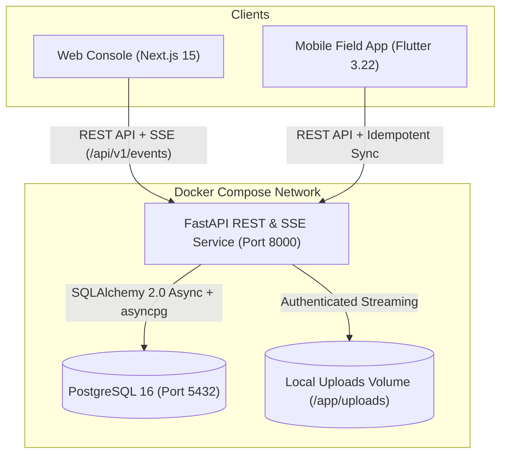

# FixFlow — Multi-Tenant Field Service Operations Platform

[](#verification--testing)
[](https://fastapi.tiangolo.com)
[](https://nextjs.org)
[](https://flutter.dev)
[](https://www.postgresql.org)

FixFlow is an enterprise field-service management platform orchestrating work orders, scheduling, technician dispatching, real-time tracking, and mobile field execution with robust multi-tenant data isolation and offline synchronization.

---

## Architecture Overview

FixFlow comprises three cohesive delivery units sharing a common PostgreSQL storage layer:



- **Backend (`/backend`)**: High-performance asynchronous API built with Python 3.13, FastAPI, SQLAlchemy 2.0 (asyncpg), Alembic, and Pydantic v2.
- **Web Frontend (`/web`)**: Modern operations dashboard built with Next.js 15 (App Router, React 19), Tailwind CSS, TanStack Query v5, and Server-Sent Events (SSE).
- **Mobile Field App (`/mobile`)**: Offline-first mobile client built with Flutter 3.22, Riverpod 2, Drift (SQLite) local storage, and background command replay.
- **Documentation (`/docs`)**: Full architecture, API contracts, design decisions, verification suites, and risk analyses.

---

## Directory Structure

```text
marat-chorchoev/
├── compose.yaml                # Production-grade multi-container orchestrator
├── .env.example                # Canonical environment variable template
├── README.md                   # Platform documentation and onboarding
├── backend/                    # FastAPI backend service
│   ├── app/                    # Application source code
│   │   ├── api/v1/             # REST endpoints (auth, requests, assignments, notes, etc.)
│   │   ├── core/               # Security, database configuration, config settings
│   │   ├── models/             # SQLAlchemy ORM declarative models
│   │   ├── schemas/            # Pydantic validation schemas
│   │   ├── services/           # Business domain logic (dispatch scoring, SLA, sync)
│   │   └── workers/            # Background tasks and event broadcast
│   ├── alembic/                # Database migrations
│   ├── tests/                  # Pytest automated test suite
│   ├── Dockerfile              # Backend container build specification
│   └── pyproject.toml          # Python dependencies and tool configuration
├── web/                        # Next.js web application
│   ├── src/
│   │   ├── app/                # App Router pages and API routes
│   │   ├── components/         # Reusable UI component library
│   │   ├── hooks/              # Custom React hooks (real-time SSE, auth)
│   │   ├── lib/                # API client and utility helpers
│   │   └── types/              # TypeScript type definitions
│   ├── __tests__/              # Unit and integration tests
│   ├── Dockerfile              # Web container build specification
│   └── package.json            # Node / Bun dependencies
├── mobile/                     # Flutter mobile application
│   ├── lib/
│   │   ├── core/               # API client, Drift database, routing configuration
│   │   ├── features/           # Feature modules (auth, jobs, notes, sync, etc.)
│   │   └── shared/             # Shared widgets, banners, and modals
│   ├── test/                   # Flutter unit and widget tests
│   └── pubspec.yaml            # Dart / Flutter dependencies
├── scripts/                    # Automation and validation scripts
│   ├── verify-all.sh           # Comprehensive multi-service lint and test runner
│   └── smoke.sh                # End-to-end API smoke test suite
└── docs/                       # Technical documentation
    ├── ARCHITECTURE.md         # Component boundaries, isolation, concurrency
    ├── API.md                  # Comprehensive API examples and usage
    ├── PRODUCT_DECISIONS.md    # Smart Dispatch feature and trade-off rationale
    ├── KNOWN_LIMITATIONS.md    # Security risks, limitations, and mitigations
    ├── VERIFICATION.md         # Verification instructions and test matrices
    └── AI_USAGE.md             # AI assistance and model disclosure
```

---

## Quickstart with Docker Compose

The fastest way to spin up the entire FixFlow stack:

### 1. Configure Environment
```bash
cd marat-chorchoev
cp .env.example .env
```

### 2. Start Services
```bash
docker compose up --build -d
```

### 3. Verify Health
```bash
# Check service status
docker compose ps

# Run automated smoke test
./scripts/smoke.sh
```

| Service | Local URL | Description |
|---|---|---|
| **Web Console** | [http://localhost:3000](http://localhost:3000) | Dispatcher and admin management portal |
| **API Server** | [http://localhost:8000](http://localhost:8000) | REST API & OpenAPI docs (`/docs`) |
| **Postgres DB** | `localhost:5432` | Relational storage (`fixflow` database) |

---

## Local Development Setup

### 1. Backend Service
```bash
cd backend

# Install dependencies with uv
uv sync

# Run database migrations
uv run alembic upgrade head

# Start development server
uv run uvicorn app.main:app --reload --port 8000
```

### 2. Web Frontend
```bash
cd web

# Install dependencies
bun install

# Start development server
bun run dev --port 3000
```

### 3. Mobile Field Client
```bash
cd mobile

# Get dependencies
flutter pub get

# Run on target device or emulator
flutter run
```

---

## Demo Credentials & Seed Data

FixFlow includes pre-configured demo users across two isolated organizations (`org1` and `org2`):

| Organization | Role | Email | Password |
|---|---|---|---|
| **Org 1** (Metro Facilities) | **Requester** | `requester1@org1.fixflow.local` | `Demo1234!` |
| **Org 1** (Metro Facilities) | **Dispatcher** | `dispatcher1@org1.fixflow.local` | `Demo1234!` |
| **Org 1** (Metro Facilities) | **Technician** | `technician1@org1.fixflow.local` | `Demo1234!` |
| **Org 1** (Metro Facilities) | **Admin** | `admin1@org1.fixflow.local` | `Demo1234!` |
| **Org 2** (Apex Maintenance) | **Dispatcher** | `dispatcher1@org2.fixflow.local` | `Demo1234!` |
| **Org 2** (Apex Maintenance) | **Technician** | `technician1@org2.fixflow.local` | `Demo1234!` |

> [!NOTE]
> Cross-tenant access between Org 1 and Org 2 is strictly blocked at the API layer, returning `403 Forbidden`.

---

## Core Capabilities & Features

### 1. Multi-Tenant Isolation
- Tenant context is derived strictly from verified JWT tokens and `X-Organization-ID` headers.
- All database queries enforce tenant isolation via explicit `WHERE org_id = :org_id` clauses and `OrgScoped` models.
- Cross-organization queries are impossible without explicit elevated administrative overrides.

### 2. Smart Dispatch Assistant
- Evaluates technician candidates using a composite scoring algorithm:
  $$\text{Score} = 0.40 \times \text{SkillMatch} + 0.30 \times \text{Availability} + 0.20 \times \text{Workload} + 0.10 \times \text{Proximity}$$
- Provides instant ranking to dispatchers to eliminate manual availability cross-checks.

### 3. Concurrency & Double-Booking Prevention
- Schedule blocks utilize transactional `SELECT ... FOR UPDATE` locks on technician schedules.
- Prevents concurrent dispatchers from reserving overlapping time windows for the same technician.
- Returns a structured `409 Conflict` containing the conflicting booking and alternate candidates.

### 4. Offline-First Mobile Synchronization
- Technicians can log notes, update status, and inspect job history entirely offline.
- Mutations are written locally to Drift (SQLite) in a durable `PendingCommands` queue.
- Re-connection triggers `SyncService` to replay operations with idempotent UUID headers (`Idempotency-Key`), preventing duplicate operations.

### 5. Live Updates via Server-Sent Events (SSE)
- Web console listens to `/api/v1/events` for real-time state changes (`REQUEST_CREATED`, `ASSIGNED`, `STATUS_CHANGED`).
- In-memory event dispatch ensures low-latency UI updates without the overhead of full WebSocket bi-directional state management.

---

## Verification & Testing

Run all linters, type checks, and automated test suites across the monorepo:

```bash
./scripts/verify-all.sh
```

Individual service test suites:

```bash
# Backend pytest suite
cd backend && uv run pytest -v

# Web test suite
cd web && bun run test

# Mobile unit & widget tests
cd mobile && flutter test

# End-to-end API smoke tests
./scripts/smoke.sh
```

---

## Documentation Links

- [Architecture Specification](docs/ARCHITECTURE.md) — System boundaries, tenant isolation, and concurrency design.
- [API Reference](docs/API.md) — Endpoint specifications, curl examples, and payloads.
- [Product Decisions](docs/PRODUCT_DECISIONS.md) — Rationale for Smart Dispatch, SSE, and Drift SQLite.
- [Known Limitations & Mitigations](docs/KNOWN_LIMITATIONS.md) — Security threat models, edge cases, and incomplete items.
- [Verification Guide](docs/VERIFICATION.md) — Step-by-step validation procedures and test matrices.
- [AI Usage Disclosure](docs/AI_USAGE.md) — Model utilization details and oversight procedures.

---

## License

Proprietary — Developed for the FixFlow Field Service Operations Benchmark.
