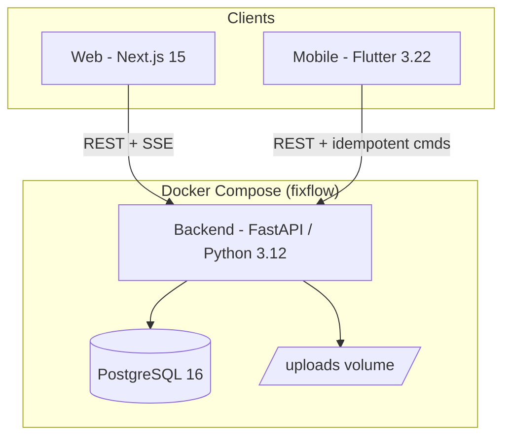
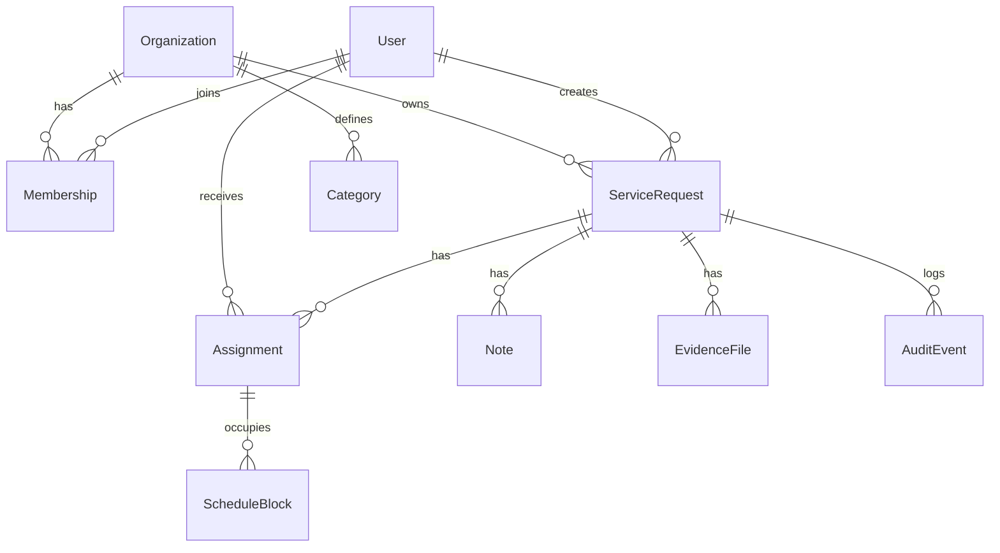

# FixFlow Architecture

## Overview

FixFlow is a multi-tenant field-service management platform. Three independent delivery units share a Postgres database and are orchestrated by Docker Compose:



## Component Boundaries

### Backend (`./backend`)
- **Framework**: FastAPI with async SQLAlchemy 2 + asyncpg
- **Auth**: JWT (HS256), tokens include `org_id` and `role`
- **Queue**: ARQ (Redis-backed) for email/notification workers; in-process fallback for dev
- **File storage**: Local volume at `/app/uploads`; served via authenticated streaming endpoint
- **Migrations**: Alembic with async driver

### Web (`./web`)
- **Framework**: Next.js 15 (App Router, React 19)
- **State**: TanStack Query v5 for server state; Zustand for UI state
- **Auth**: HTTP-only cookie with JWT; `middleware.ts` redirects unauthenticated requests
- **Real-time**: SSE (`/api/v1/events`) for live request / assignment updates

### Mobile (`./mobile`)
- **Framework**: Flutter 3.22
- **State**: Riverpod 2 + AsyncNotifier
- **Offline**: Drift (SQLite) caches jobs; `PendingCommands` table queues mutations
- **Sync**: `SyncService` replays pending commands with idempotency keys on reconnect

## Database Schema Overview



Key tables:

| Table | Purpose |
|---|---|
| `organizations` | Tenant root; every row keyed by `org_id` |
| `users` | Global user accounts |
| `memberships` | User ↔ Org with role (`REQUESTER`, `DISPATCHER`, `TECHNICIAN`, `ADMIN`) |
| `service_requests` | Core work-order entity |
| `assignments` | Technician allocation with schedule window |
| `schedule_blocks` | Reserved time for conflict detection |
| `notes` | Rich-text + attachments log |
| `evidence_files` | Uploaded photos/docs |
| `audit_events` | Immutable event log for every state change |
| `categories` | Org-defined request classification |

## Tenant Isolation Strategy

Every authenticated request carries a JWT containing `org_id`. The `get_current_membership` dependency:

1. Validates the JWT and extracts `user_id` + `org_id`.
2. Looks up `Membership(user_id, org_id)` and raises `403` if absent or inactive.
3. Injects the `Membership` object into route handlers.

All service-layer queries include an explicit `WHERE org_id = :org_id` filter. SQLAlchemy model base classes expose an `org_id` column; a custom `OrgScoped` mixin raises if a query omits it. Database rows are never cross-org joinable without an explicit override.

## Concurrency Strategy

### Schedule Conflict Prevention
Assignments target a `(technician_id, start_time, end_time)` window. Before inserting:

```sql
SELECT id FROM schedule_blocks
WHERE technician_id = :tid
  AND tsrange(start_time, end_time) && tsrange(:start, :end)
FOR UPDATE;
```

If any row is returned the endpoint returns `409 Conflict` with candidate alternatives from the Smart Dispatch ranking. The `FOR UPDATE` lock prevents two concurrent dispatchers from double-booking the same slot.

### Idempotency
Mobile offline commands include an `idempotency_key` (UUID v4 generated on device). The backend stores processed keys in `audit_events.idempotency_key` with a unique constraint; replayed commands return the original response body from the stored result rather than re-executing.

## File Storage

Files are written to `/app/uploads/{org_id}/{request_id}/{uuid}.{ext}` on the Docker volume. Uploads are:
- Size-limited to 20 MB per file (configurable via `MAX_UPLOAD_BYTES`).
- MIME-verified with `python-magic` (checks file magic bytes, not just Content-Type header).
- Served via `GET /api/v1/files/{file_id}` which checks membership before streaming.

## SLA Calculation

Each `Category` carries an optional `sla_hours` field. When a `ServiceRequest` is created:

- `sla_deadline = created_at + INTERVAL sla_hours`
- A background ARQ job runs every 5 minutes and sets `sla_breached = True` on overdue open requests, emitting an `AuditEvent` and sending dispatcher notifications.

SLA status is returned on every request list/detail response so the frontend can display the traffic-light indicator.

## Real-time Updates (SSE)

The backend exposes `GET /api/v1/events?org_id=<id>` as a Server-Sent Events stream. On any state transition (`REQUEST_CREATED`, `ASSIGNED`, `IN_PROGRESS`, `COMPLETED`, etc.) the backend publishes a JSON event to an in-process `asyncio.Queue` keyed by `org_id`. All connected SSE clients for that org receive the event within ~100 ms.

For the mobile app, the Flutter client polls `GET /api/v1/jobs/my` on foreground resume and uses `flutter_local_notifications` for push-equivalent alerts when offline.
